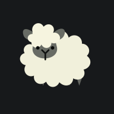

# Herdr Workbench



牧羊人的 AI 工作台：以專案分類，和一個總控聊天，再依需要加入多個 Claude、Codex 或 MiniMax 代理。角色、數量與分工由專案決定，不寫死工作流程。

這是獨立倉庫，衍生自 [Herdr 的 team-work 擴充](https://github.com/virus11456/herdr/tree/master/extensions/team-work)。授權與來源見 [LICENSE](LICENSE)、[NOTICE](NOTICE)。

## 架構

一台常開的 Mac 執行 Web、背景佇列與 `herdr-core (hc)`；其他 Mac、iPhone、iPad 加入同一個 Tailscale 網路，透過 HTTPS 使用 PWA。任務與瀏覽器操作發生在主機，使用主機已授權的工具與帳號。

背景版直接使用 `hc`，不依賴 Herdr 桌面版。選用的舊原生介面仍保留在 `mods/`，使用 `install.mjs` 安裝時需要支援 gpui-kit 的 Herdr 桌面版，舊 TUI 無法替代。

## 安裝前

背景安裝器目前支援 macOS。Windows 不支援這套 POSIX 啟動器，Linux 服務安裝未經實機驗證。

先從官方來源安裝依賴並加入 PATH，由使用者完成登入、信任與授權：

| 依賴 | 官方說明 |
| --- | --- |
| Node.js 20+，建議 24 LTS | [Node.js](https://nodejs.org/)，各代理可能需要更高版本 |
| herdr-core `hc` | [獨立安裝](https://github.com/herdrdev/herdr-core#install)，不必下載桌面版 |
| Claude Code | [安裝與登入](https://code.claude.com/docs/en/setup) |
| Codex CLI | [官方專案](https://github.com/openai/codex) |
| MiniMax Code `mcode` | [官方專案](https://github.com/MiniMax-AI/minimax-code) |
| Tailscale | [官方下載](https://tailscale.com/download)，各裝置加入同一 tailnet |
| Google Drive 桌面版（選用） | [官方安裝及登入](https://support.google.com/drive/answer/10838124) |

安裝器檢查依賴，但不包含第三方二進位或帳號資料，不代答任何登入、權限或付費確認，不停用沙箱。

## 一次設定，背景執行

```sh
git clone https://github.com/virus11456/herdr-workbench.git
cd herdr-workbench
./Install.command
```

私人倉庫需自己的 GitHub 讀取權，也可下載 ZIP 解壓後開啟 `Install.command`。安裝器詢問 Tailscale HTTPS origin（不含 `/herdr`）與本人 LoginName，顯示範圍後再確認安裝。可在 `tailscale status --json` 核對自己的 DNSName 與使用者資料。

終端安裝與預覽：

```sh
node setup.mjs --dry-run --origin https://your-host.your-tailnet.ts.net --login owner@example.com
node setup.mjs --origin https://your-host.your-tailnet.ts.net --login owner@example.com
```

`--dry-run` 不寫入、不啟動代理。`--no-start` 只安裝、不啟動服務。所有既有同名檔案先備份至 `~/.config/herdr-workbench/backups/<批次>/`，附還原清單；備份留在本機。

安裝目錄為 `~/.config/herdr-workbench/`，Web 預設埠 `48724`。兩個使用者 LaunchAgent 是 `dev.herdr.workbench-web` 與 `dev.herdr.workbench-queue`。登入 macOS 後自動執行；主機仍需開機且保持登入，不會自動更改睡眠設定或取得管理員權限。

### Tailscale 私人入口

依 Tailscale 官方說明開啟 Serve 後執行：

```sh
tailscale serve --bg --set-path=/herdr http://127.0.0.1:48724
```

保留其他既有 Serve 路徑，不要 reset；不使用 Funnel。另一台已加入同一 tailnet 的裝置開啟 `https://your-host.your-tailnet.ts.net/herdr/`。Web 只綁 loopback，並驗證本人 Tailscale 身分、Origin 與 CSRF；不可直接公開轉送此埠。

目前是同一使用者的跨裝置工作台，尚未提供多租戶 SaaS 隔離。

### Google Drive 與儲存

主機安裝 Google Drive 桌面版，親自登入並選擇串流檔案。在 PWA「專案管理 → 連線與儲存」查看狀態、指定主機的 Drive 專案資料夾；也能重新執行 `node setup.mjs --drive-root "<Finder 核對的串流資料夾>"`。

變更只影響新專案，現有專案不自動搬動。程式不收 Google 密碼；登入與重新授權在 Google 官方桌面版處理。所有客戶端操作同一後台，由主機統一讀寫專案檔案。

新專案的控制檔、對話、請求與角色設定保存在主機 `runtime/projects/`，不放入 Drive。資料夾「已設定」不代表雲端上傳驗證通過，需確認 Drive 同步狀態並回讀檔案。釋放空間只用檔案提供者的「移除下載項目」，不得刪除同步原檔；執行中、未驗證資料必須保留。本倉庫不帶作者的私人備份排程。

## 日常操作

1. 新增／選擇專案，預設只有一個總控。
2. 左側「加入新代理」可選名稱、引擎與職責；同一引擎可加入多位。保存設定不啟動代理。
3. 聊天交付目標，總控依名冊安排；起手建議只填草稿。
4. 點代理標題可改名；專案管理可編輯其他角色、查看對話與詳細紀錄。

Chrome 可安裝 PWA；iPhone / iPad Safari 用「分享 → 加入主畫面」。圖示為 SVG 綿羊。離線僅保留介面外殼，不快取對話、憑證、API 回應或排入任務。

登入、信任、權限與付款提示在主機親自確認。沒有桌面版時，在主機 `hc ls` 查真實終端，再以 `hc attach <終端ID>` 接管。瀏覽器工具需自行授權；有多個瀏覽器時不能隨選。

## 協作與測試

`queued` 只是排隊；需核對 `first_message.sent`、真實回報及成果。沙箱通道必須從目前真實總控送出請求，再讀同一 ID 的結果：

```sh
herdr-team-runtime --chat <目前對話ID> request list '{}'
herdr-team-runtime --chat <目前對話ID> response <同一請求ID>
```

只有目前總控能操作該專案與團隊。不得偽造終端 ID、複製其他電腦的 `control.json` 或關閉沙箱。Codex 啟動器保留既有權限設定，不加入額外可寫目錄。官方通知 hook 只在核對真實父子終端與專案綁定後，把已登記 worker 的回覆送回目前總控；它不接受任意命令或替代理解除沙箱。

```sh
node --test team-runtime.test.mjs background.test.mjs web/server.test.mjs web/format.test.mjs
```

自動測試使用隔離目錄與模擬 core，不花模型額度。開發期間已做過三種引擎派工回報、兩個 Codex 透過總控交接的實測；這不是其他帳號／新機的保證。背景啟動、關閉桌面後運作及手機版面仍須分別依版本實測，不能用單元測試取代。

## 更新、移轉與還原

更新此倉庫後先重跑 `node setup.mjs --dry-run`，檢查範圍再安裝。既有設定沿用並備份，不覆寫專案檔案。

`--import-desktop` 可登錄本機原生介面的專案與對話位置，保留原位置，不複製憑證。舊專案 runtime 保持相容位置，新專案採分離的私人 runtime。這不是跨電腦帳號搬移工具。

停止服務：`launchctl bootout gui/$(id -u)/dev.herdr.workbench-web`，以及對應的 `queue` job。還原前先停止服務，再依本機備份清單恢復；不要刪除專案或帳號設定。停止 Web 不會自動終止 core 中的代理。

## 發佈範圍

只收錄程式、圖示、範本、測試與文件。不得提交 `service.json`、`web/config.json`、專案清單、對話、`.herdr-team/`、token、API key、Cookie、私人金鑰、安裝備份或本機測試成果。

## 多代理共用任務清單

多步驟任務由總控先列出工作、負責代理及驗收條件。聊天內顯示「任務清單 · 完成數／總數」，可展開查看內容；不另開協作紀錄頁。未完成項目會保留，接手總控先讀清單，避免漏做或重複派工。

總控先執行 `herdr-team-runtime checklist` 取得 revision，再以 `request checklist` 提交單一項目，讀取同 ID 的 response 確認成功。每個項目都有 `id`、`title`、`owner`、`acceptance`、`status` 和目前 `revision`。狀態為 pending、in_progress、blocked 或 done；blocked 必須寫 reason。

只有目前總控能更新；版本不符會拒絕寫入。done 必須提供總控的 `verification` 驗收說明，以及 `evidence`：專案內檔案的相對路徑與 SHA-256（type=file），或已成功完成的終端 read 請求 ID 和 response.result JSON 的 SHA-256（type=response）。系統核對來源、完成狀態及雜湊，語意是否符合驗收條件仍由總控負責。queued、啟動成功或代理自稱完成，都不能單獨標記 done。此機制不額外賦予代理檔案或終端權限。

既有執行中的總控會在下一次收到任務時取得新版協作提示；不會為更新自動送出任務。
