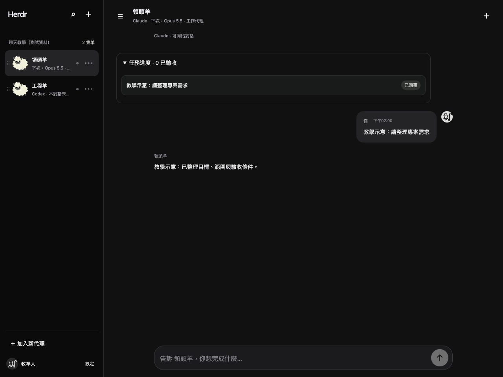

# Herdr Workbench


牧羊人的 AI 工作台。每個專案從一隻「領頭羊」開始，牠可以拆解目標、派工、收回報和驗收。你也能直接和 Claude、Codex、MiniMax 或 Google 個人版 Antigravity 代理聊天，交付任務或附檔。領頭羊可改名和設定模型，你也能任命其他代理協調。

目前版本 **0.8.11-dev · v43**（介面版本 `20261122-live43`）。下載 [macOS 安裝包](downloads/herdr-workbench-0.8.11-dev.zip) 和 [SHA-256](downloads/herdr-workbench-0.8.11-dev.zip.sha256)，解壓後開啟 `Install.command`。安裝包使用官方 CLI 依賴，驗證範圍見 [VALIDATION.md](VALIDATION.md)。

v43 使用即時通知更新訊息和狀態，斷線時保留輪詢與重連。歷史對話增量解析並快取，最新保存的專案記憶優先於舊片段。等待時顯示原因、經過時間和最後進度；附件提供圖片預覽、上傳百分比及失敗重試。側欄直接列出專案名稱，新增與編輯專案只需處理名稱。

這是獨立倉庫，衍生自 [Herdr 的 team-work 擴充](https://github.com/virus11456/herdr/tree/master/extensions/team-work)。授權與來源見 [LICENSE](LICENSE)、[NOTICE](NOTICE)。

## 架構

一台常開的 Mac 執行 Web、背景佇列與 `herdr-core (hc)`；其他 Mac、iPhone、iPad 加入同一個 Tailscale 網路，透過 HTTPS 使用 PWA。任務與瀏覽器操作發生在主機，使用主機已授權的工具與帳號。

背景版直接使用 `hc`，不依賴 Herdr 桌面版。選用的舊原生介面仍保留在 `mods/`，使用 `install.mjs` 安裝時需要支援 gpui-kit 的 Herdr 桌面版，舊 TUI 無法替代。

## 安裝前

背景安裝器目前支援 macOS。Windows 不支援這套 POSIX 啟動器，Linux 服務安裝未經實機驗證。

先從官方來源安裝依賴並加入 PATH，由使用者完成登入、信任與授權：

| 依賴 | 官方說明 |
| --- | --- |
| Node.js 20+，建議 24 LTS | [Node.js](https://nodejs.org/)，各代理可能需要更高版本 |
| herdr-core `hc` | [獨立安裝](https://github.com/herdrdev/herdr-core#install)，不必下載桌面版 |
| Claude Code | [安裝與登入](https://code.claude.com/docs/en/setup) |
| Codex CLI | [官方專案](https://github.com/openai/codex) |
| MiniMax Code `mcode` | [官方專案](https://github.com/MiniMax-AI/minimax-code) |
| Antigravity CLI `agy`（Google 個人帳號） | [官方安裝](https://antigravity.google/docs/getting-started?tab=cli)、[個人帳號登入](https://antigravity.google/docs/install?tab=cli) |
| Tailscale | [官方下載](https://tailscale.com/download)，各裝置加入同一 tailnet |
| Google Drive 桌面版（選用） | [官方安裝及登入](https://support.google.com/drive/answer/10838124) |

安裝器檢查依賴，但不包含第三方二進位或帳號資料，不代答任何登入、權限或付費確認，不停用沙箱。

### Google 個人版

Google 官方公告：自 2026-06-18 起，免費個人帳號與 Google AI Pro／Ultra 的 Gemini CLI 使用方式改到 Antigravity CLI；企業與 API 金鑰另有規則。參考 [官方轉移公告](https://developers.googleblog.com/an-important-update-transitioning-gemini-cli-to-antigravity-cli/)。本工作台的「Google / Antigravity」使用 `agy`，不會自動設定 API 金鑰、Google Cloud 專案或按量付費。

先依官方說明安裝 `agy` 並確認 `agy --version`。在主機終端啟動 `agy`，由本人完成 Google OAuth、條款及必要授權，再於左側「加入新代理」選擇「Google / Antigravity」。保存設定不會啟動代理；你可直接和它聊天，也能授權其他代理向它交付協作。登入成功仍需實際任務、真實回報與驗收，不能以安裝成功代替協作通過。

## 一次設定，背景執行

```sh
git clone https://github.com/virus11456/herdr-workbench.git
cd herdr-workbench
./Install.command
```

私人倉庫需自己的 GitHub 讀取權，也可下載 ZIP 解壓後開啟 `Install.command`。安裝器詢問 Tailscale HTTPS origin（不含 `/herdr`）與本人 LoginName，顯示範圍後再確認安裝。可在 `tailscale status --json` 核對自己的 DNSName 與使用者資料。

終端安裝與預覽：

```sh
node setup.mjs --dry-run --origin https://your-host.your-tailnet.ts.net --login owner@example.com
node setup.mjs --origin https://your-host.your-tailnet.ts.net --login owner@example.com
```

`--dry-run` 不寫入、不啟動代理。`--no-start` 只安裝、不啟動服務。所有既有同名檔案先備份至 `~/.config/herdr-workbench/backups/<批次>/`，附還原清單；備份留在本機。

安裝範圍也包含官方回覆 hook：Claude 的工作台專用設定、Codex 的單次會話 notify，以及 Google `~/.gemini/config/hooks.json`、MiniMax `~/.minimax/hooks.json`。既有內容先備份、保留其他 hook；不替使用者開啟原本停用的 MiniMax 全域 hooks。這些介面只接收已登記的真實代理回覆與限定的專案協作動作，不修改工具權限、信任或沙箱。

0.8.10-dev v42-memory 已在全新 macOS 15.8.2（Apple Silicon）雲端虛擬機使用公開 ZIP 實際安裝。驗收包含官方 CLI、兩個使用者 LaunchAgent、四個 Core 範本、本機工作台、歷史記憶模組與 86 項測試；登入、Drive、Tailscale 跨裝置連線和重開機仍需實機驗證。[雲端安裝驗收](https://github.com/virus11456/herdr-workbench/actions/runs/44932391371)

安裝目錄為 `~/.config/herdr-workbench/`，Web 預設埠 `48724`。兩個使用者 LaunchAgent 是 `dev.herdr.workbench-web` 與 `dev.herdr.workbench-queue`。登入 macOS 後自動執行；主機仍需開機且保持登入，不會自動更改睡眠設定或取得管理員權限。

### Tailscale 私人入口

依 Tailscale 官方說明開啟 Serve 後執行：

```sh
tailscale serve --bg --set-path=/herdr http://127.0.0.1:48724
```

保留其他既有 Serve 路徑，不要 reset；不使用 Funnel。另一台已加入同一 tailnet 的裝置開啟 `https://your-host.your-tailnet.ts.net/herdr/`。Web 只綁 loopback，並驗證本人 Tailscale 身分、Origin 與 CSRF；不可直接公開轉送此埠。

目前是同一使用者的跨裝置工作台，尚未提供多租戶 SaaS 隔離。

### Google Drive 與儲存

主機安裝 Google Drive 桌面版，親自登入並選擇串流檔案。在 PWA「設定 → 連線與儲存」查看狀態、指定主機的 Drive 專案資料夾；也能重新執行 `node setup.mjs --drive-root "<Finder 核對的串流資料夾>"`。

變更只影響新專案，現有專案不自動搬動。程式不收 Google 密碼；登入與重新授權在 Google 官方桌面版處理。所有客戶端操作同一後台，由主機統一讀寫專案檔案。

新專案的控制檔、對話、請求與角色設定保存在主機 `runtime/projects/`，不放入 Drive。資料夾「已設定」不代表雲端上傳驗證通過，需確認 Drive 同步狀態並回讀檔案。釋放空間只用檔案提供者的「移除下載項目」，不得刪除同步原檔；執行中、未驗證資料必須保留。本倉庫不帶作者的私人備份排程。

## 圖解教學

完整操作流程見 [工作台操作教學](docs/USAGE.md)：建立專案、加入及改名代理、跨裝置接續、交付任務、主機授權與成果驗收。截圖使用專用教學專案；響應式尺寸與 iOS 實機結果分開記錄。


## 日常操作

1. 建立專案，先有一隻不能刪除的「領頭羊」；保存設定不會啟動代理。
2. 左側「加入新代理」選名稱、引擎與職責；同一引擎可以有多位。
3. 每個專案的每位代理各有一條時間線。點某隻羊，舊訊息和最新回報依日期排在同一頁。也可用 `@代理名稱` 指定收件人。
4. 要分工時，把目標或指定人選寫進訊息。從左下「設定 → 任務進度」追蹤交付、回報及驗收，或從舊訊息點「查看原任務」。
5. 點代理右側「⋯」管理 Pin、設定、重新命名、轉移專案或刪除；「設定」內可選 Claude 的 Opus／Fable，或按「任命為協調者（Opus）」。協調者預設 Claude Opus 5.5；切換執行中模型必須等 CLI 真正確認。
6. 從側欄專案名稱右側的編輯按鈕改名，原資料夾、專案 ID、檔案與對話都會保留。起手建議只會填入草稿。

同一代理接續其他舊對話時，工作台會提供近期與本次問題相關的歷史片段及來源日期，包含原附件路徑。每回合歷史片段最多約 24,000 字元，較長的單則訊息會標記截斷。長期重要決策也可存入「設定 → 專案記憶」。舊訊息中的操作和授權按歷史資料處理，執行仍依當前任務。

### 三種派工方式

| 要做的事 | 操作 |
| --- | --- |
| 指定誰做 | 在領頭羊的對話輸入「請分析需求，交給工程師實作。收到測試結果後由你驗收。」 |
| 由領頭羊決定分工 | 只交代目標和完成條件。領頭羊會依職責選同專案成員。專案只有領頭羊且確實需要分工時，牠可以建立一位代理再派工。 |
| 直接交辦 | 點側欄的代理，再送出任務。在訊息開頭輸入 `@代理名稱` 也可以直接指定收件人。 |

### 聊天附件

點輸入框旁的迴紋針，選檔後請告訴代理要讀什麼，例如「只讀取附件中的 CSV，核對合計與缺值」。每則最多 4 個檔案，每檔上限 15 MB。按送出時才上傳到目前專案的「Herdr 附件」資料夾，收件代理依專案內的路徑讀取。Google Drive 專案的附件也在同一專案目錄。詳細步驟見 [操作教學](docs/USAGE.md#附檔給代理)。

圖片可在送出前預覽，上傳會顯示進度。失敗時保留草稿和已選附件，按「重試傳送附件與訊息」續試；同一筆訊息沿用識別碼，以核對主機先前的收件結果。

模型顯示以 CLI 參數、成功切換確認或官方回覆事件為準；未啟動者顯示引擎與「本對話未啟動」，Claude 顯示「下次使用」，不猜測已生效的模型。代理在首次使用後可常駐待命；每個專案、對話與代理各有會話，新對話不混用其他聊天上下文。指定協調者是使用者的選擇，一般代理對話仍直接送達。既有舊版總控與對話保留相容性，不會擅自刪除。總控終端若已刪除，可明確按「重新開啟總控」續接，原本佇列訊息保留；詳細流程見 [操作教學](docs/USAGE.md)。

工作中的羊會輕輕晃動、綠點緩慢閃爍；聊天裡以「…」區分傳送、排隊、送達及回覆中。等待權限時停止忙碌動畫，收到真實回覆後移除提示。尊重系統減少動態效果設定，文字狀態仍可見。[圖解與狀態說明](docs/USAGE.md#羊的動作與回覆提示)。

綠燈表示 CLI 已連線且可用，待命恆亮、工作閃爍；未啟動、未連線、已結束、shell 或等待登入／權限時為灰燈。已在同一台 Mac 第二次真正重開機確認，登入後 Tailscale 與兩個背景服務自行恢復，不需手動 Connect 或開 Herdr；專案與對話保留。模型 CLI 在訊息到達時續接，細節與新機限制見 [驗證結果](VALIDATION.md)。

側欄將模型和狀態分開顯示。已連線的代理顯示目前確認的模型，沒有啟動的代理保留該專案的上次模型；對尚無回報的代理顯示已選的下次模型或引擎。

側欄可用滑鼠拖曳排序，Pin 的代理固定在上方；亦可從「⋯」向上／向下移動。拖到另一個專案名稱，或選「移至其他專案」，會先顯示目的專案與保留範圍。轉移／刪除前核對所有對話的排隊訊息與未完成協作，保留原對話及檔案；預設領頭羊不能刪除或移出，現任協調者需先完成交接。[新版側欄教學](docs/USAGE.md#側欄拖曳與代理選單)。

Chrome 可安裝 PWA；iPhone / iPad Safari 用「分享 → 加入主畫面」。圖示為 SVG 綿羊。離線僅保留介面外殼，不快取對話、憑證、API 回應或排入任務。

登入、信任、權限與付款提示在主機親自確認。沒有桌面版時，在主機 `hc ls` 查真實終端，再以 `hc attach <終端ID>` 接管。瀏覽器工具需自行授權；有多個瀏覽器時不能隨選。

代理在啟動／信任階段尚未就緒就結束時，服務會停止等待；親自按「重新開啟代理」才重試，不反覆重開提示。一位代理等待權限不會阻擋其他代理聊天。首次仍需工具載入與本人確認，不能保證每個模型固定秒數回覆。

## 協作與測試

`queued` 只是排隊。直接聊天由正式 Web 的身分／Origin／CSRF 檢查送入指定代理；官方回覆 hook 再核對真實終端、專案與對話綁定。協作會在同一專案的成員間交付。動作由工作台核對並執行，範圍限於建立代理、派工、退回與驗收。每個協作有 ID、版本、完成條件、真實回覆與終端讀取證據，原代理核對後才可驗收；不符合可以要求修正。

舊總控相容模式的沙箱請求仍須由目前真實總控送出，再讀同一 ID 的結果：

```sh
herdr-team-runtime --chat <目前對話ID> request list '{}'
herdr-team-runtime --chat <目前對話ID> response <同一請求ID>
```

這段舊通道只允許目前總控操作其登記的工作終端。新直接對話與協作不偽裝成總控、不偽造 `HC_TERMINAL_ID`、不改寫 `control.json`。Codex 保留既有權限設定，Antigravity 使用 `--sandbox`；不加入額外可寫目錄、不代答授權。

```sh
npm ci --ignore-scripts --no-audit --no-fund
npm test
```

自動測試使用隔離目錄、模擬 core 及真正的隔離 Node 子程序，不花模型額度。已另做四引擎直接回覆、Opus／Fable 真切換、Opus 向 Codex 交付後退回修正並驗收、Drive 原始檔雲端回讀；實機與新機限制均獨立記錄，不用單元測試代替。

## 任務進度與提醒

0.5.1 已移除 8-bit 牧場、地圖入口與顯示設定，回到以聊天為主的介面。所有專案的代理數、名單、排序與 Pin 保留；側欄原有綿羊頭像和工作提示也保留。

「任務進度」顯示排隊、送達、工作、回覆、待驗收與已驗收；排隊不算完成，收到回覆也不代表成果通過驗收。「需要你確認」提供對應代理與真實主機終端的處理方式，權限仍由你親自決定。



新增代理時只填名稱、選引擎；模型、職責標籤和工作說明可之後從代理的「⋯ → 設定」調整。點側欄專案右側的編輯按鈕，可修改專案名稱。

展開任務卡可取消尚未送出的聊天訊息。已送達的直接聊天可在 Core 確認仍是同一個執行回合時停止。Core 回報中斷且終端離開執行狀態後才顯示「已停止」。已寫入的檔案會保留。舊總控或代理間協作的執行中回合目前由主機終端處理。

取消後可從任務卡按「重新編輯」，已確認停止則可按「準備接續」。兩者只填入草稿。已有草稿時，請先處理原草稿。「準備接續」會請代理先查看已完成的成果，再做剩餘工作。

已驗收且雜湊仍一致的專案成果可從任務卡預覽或下載。位於主機 Google Drive 串流資料夾且已取得檔案 ID 的成果，預覽視窗會顯示「在 Google Drive 開啟」，直接開啟同一份原檔。圖片、文字、程式碼和 diff 可預覽，PDF 可下載。檔案改動後需重新驗收。

在領頭羊旁選「⋯ → 設定 → 使用引擎」可選 Claude 或 Codex。Claude 可選 Opus 5.5 或 Fable 5.2。Codex 使用主機 Codex CLI 的模型設定。儲存後保留同一對話，引擎在下一則訊息交付時啟用。切換舊總控前會等待目前工作和已派出的任務；任命既有代理為領頭羊時，沿用原引擎。

「設定 → 專案記憶」保存專案目標、偏好和決策。後續派工會讀取當下保存的內容，並可隨時編輯、清空。

「設定 → 用量與額度」顯示更新後同一對話中已記錄回合的 token。Claude、Codex、MiniMax 與 Google Antigravity 的數字來自 CLI 的結構化紀錄。輸出直接使用引擎回報的值，Codex 輸入已包含快取，不重複加總。送達與回覆另外以最近 300 筆事件計算。

「帳號剩餘額度」另列出引擎回報的剩餘百分比、重設時間與回報時間。重設後該額度會暫時隱藏，等 CLI 回報新資料。

| 引擎 | 額度來源與更新時機 |
| --- | --- |
| Claude | 官方 CLI 狀態列提供已用的 5 小時／每週額度，工作台換算成剩餘比例。CLI 會在該會話收到 API 回應後提供可用週期。 [Claude Code 狀態列](https://code.claude.com/docs/en/statusline) |
| Google Antigravity | 官方 CLI 狀態列提供各模型群組的剩餘比例。主機收到新回報後，各專案共用最近的帳號快照。 [Antigravity 狀態列](https://antigravity.google/docs/cli/statusline/) |
| Codex | 使用已登入主機的 Codex App Server 查詢帳號額度，跨專案共用。開啟工作台時最多每 5 分鐘查一次，15 分鐘沒有可用回報時暫時隱藏。查詢不會啟動模型回合。 [Codex App Server](https://learn.chatgpt.com/docs/app-server) |
| MiniMax | 官方 `mmx quota show --output json` 直接提供各類別、各週期的剩餘比例。使用工作台時最多每 5 分鐘查一次；15 分鐘沒有可用回報時暫時隱藏。 [MiniMax M Plan](https://www.minimax.io/m-plan) · [MiniMax 官方 CLI](https://github.com/MiniMax-AI/cli) |

啟用 MiniMax 額度時，從 [MiniMax 官方 CLI](https://github.com/MiniMax-AI/cli) 安裝 `mmx`（已驗證 `mmx-cli@1.0.29`）。在主機終端執行 `mmx auth login`，用與 MiniMax Code 相同的帳號和區域親自完成 OAuth，再執行 `node setup.mjs --dry-run` 確認 `miniMaxQuota` 為 `true`，最後執行 `node setup.mjs`。之後開啟 Herdr 設定即可查看。工作台透過官方 CLI 使用登入，不讀取或保存憑證。未安裝 `mmx` 的主機仍可使用 MiniMax 聊天與 token 統計。

Claude 與 Antigravity 在新版啟動器開啟的會話收集額度，原先已開啟的會話可繼續使用，待下次啟動新版會話後開始回報。工作台保留既有自訂狀態列命令，並只在主機私有資料夾保存額度數字與時間。現有來源沒有可對應回合的實付費用，金額欄位不顯示。

參考資料：[Claude Code hooks](https://code.claude.com/docs/en/hooks) · [Codex CLI 原始碼](https://github.com/openai/codex) · [MiniMax Code SDK 用量](https://github.com/MiniMax-AI/minimax-code/blob/main/packages/code-sdk/README.md) · [Antigravity CLI hooks](https://antigravity.google/docs/hooks)

「設定 → 維護工作」可填入問題，準備請代理在獨立 worktree 修正及測試的草稿。代理回報變更和測試後，由使用者另外核准合併、部署或發布。

### 手機背景通知

1. iPhone／iPad 從主畫面的 Herdr PWA 開啟；保持主機開機、背景服務及網路正常。
2. 在想追蹤的對話，進入「設定 → 通知 → 開啟此對話通知」，親自處理系統授權。不同裝置需各自開啟；可追蹤多段對話。
3. 點「傳送測試通知」，確認手機實際收到。畫面顯示「通知服務已接受」只是傳送受理，不能當裝置送達證據。
4. 點通知回到對應專案、對話與代理；需要同一 Tailnet 連線才能讀取私人介面。
5. 「關閉此裝置通知」移除此裝置在主機登記的全部對話通知，並取消瀏覽器訂閱；其他裝置保留。

通知採 Web Push，可在 PWA 關閉時由裝置服務接收，仍受系統通知設定、網路與省電機制影響。主機每 15 秒檢查已訂閱對話的真實 blocked 狀態，同一等待事件只提醒一次；解除後再次等待才重新提醒。通知只顯示通用確認文字，不傳送對話內容、任務名稱或登入資料。加密推播經裝置的 Apple／Google／Mozilla／Microsoft 服務傳送；私人介面仍維持 loopback＋Tailscale，沒有開啟 Funnel。

已在一台 iPhone 實測，從應用程式切換器完全滑掉 Herdr 後，主機發送的測試通知仍可送達，點開也能回到原對話。此驗收只確認該裝置和測試通知。

VAPID 私鑰與裝置訂閱只保存在主機本機 `notifications/`，不在 Drive、GitHub 或安裝包內。安裝器使用鎖定版本的 `npm ci --omit=dev --ignore-scripts` 安裝 web-push 依賴；需要 Node.js 隨附的 npm 及網路。沒有預設替使用者開啟通知。

推播依據 [WebKit 官方說明](https://webkit.org/blog/13878/web-push-for-web-apps-on-ios-and-ipados/) 與 [web-push 官方函式庫](https://github.com/web-push-libs/web-push)。

## 跨裝置同步

同一個 PWA 入口讀取同一主機資料。「設定 → 複製對話連結」會保留 project、chat 與目前 agent，另一台裝置開啟同一位置。名冊是專案共用；不同對話可以各自保留，不強迫其他裝置跳走。主機更新後，重新開啟 PWA 即可載入新版。草稿自動保存在目前裝置。

排序與 Pin 是專案共用設定，會同步到同一入口的其他裝置。已由真正 iPhone 確認電腦設定的排序／Pin，再由手機置頂、觀察已開啟電腦頁面自動更新，沒有手動重新整理。

代理轉移會保留名稱、引擎、模型、職責與 Pin；原對話和檔案仍留在原專案，目的專案使用自己的會話。已用既有 Claude 代理實際往返轉移：完整設定一致，兩份原對話的既有位元組 SHA-256 一致。這不是將舊聊天搬進目的專案。

舊原生 mod 的索引與背景工作台並非即時雙向同步；日常跨裝置使用同一個 PWA。匯入桌面版只登錄既有資料位置。

## 更新、移轉與還原

更新此倉庫後先重跑 `node setup.mjs --dry-run`，檢查範圍再安裝。既有設定沿用並備份，不覆寫專案檔案。

`install.mjs` 是舊原生 mod 安裝器；已裝背景工作台時會拒絕覆寫同名啟動器，請使用 `setup.mjs`。新的直接代理對話、任命與協作流程以 PWA 為準。

`--import-desktop` 可登錄本機原生介面的專案與對話位置，保留原位置，不複製憑證。舊專案 runtime 保持相容位置，新專案採分離的私人 runtime。這不是跨電腦帳號搬移工具。

停止服務：`launchctl bootout gui/$(id -u)/dev.herdr.workbench-web`，以及對應的 `queue` job。還原前先停止服務，再依本機備份清單恢復；不要刪除專案或帳號設定。停止 Web 不會自動終止 core 中的代理。

## 安裝後與重開機檢查

在安裝來源目錄執行 `node verify-host.mjs`。這是唯讀檢查：Node／CLI 版本、兩個背景服務、佇列心跳、worker 範本、真正 Tailscale HTTPS 入口及已設定 Drive 資料夾。它不印出私人設定、憑證或對話，也不會啟動代理或接受權限。`passed=true` 代表這些當下檢查通過，不代表三種引擎都已登入。

驗證重新開機時，先完成或停止自己的工作並保存檔案，親自重開機、登入 macOS 與 Tailscale，再跑一次檢查。只有實際重開機後讀到新 bootTime 且服務恢復，才記錄重開機通過；本版本仍待新機及重開機實測。

## 發佈範圍

只收錄程式、圖示、範本、測試與文件。不得提交 `service.json`、`web/config.json`、專案清單、對話、`.herdr-team/`、token、API key、Cookie、私人金鑰、安裝備份或本機測試成果。

## 多代理共用任務清單

聊天內顯示「任務清單 · 完成數／總數」，不另開協作紀錄頁。直接代理的每份協作自動列出交付者、接收者、完成條件及驗收證據。等待子協作時，父任務不會因一則「還在等待」答覆而被當成完成。兩個代理同時回報會序列化保存，避免覆蓋其他人的進度。

總控先執行 `herdr-team-runtime checklist` 取得 revision，再以 `request checklist` 提交單一項目，讀取同 ID 的 response 確認成功。每個項目都有 `id`、`title`、`owner`、`acceptance`、`status` 和目前 `revision`。狀態為 pending、in_progress、blocked 或 done；blocked 必須寫 reason。

以上指令只用於舊總控相容清單。新版直接協作由原交付代理負責驗收，必須已有官方 hook 真實回報及真實終端讀取證據，再附驗收說明；提供檔案證據時會檢查專案範圍與 SHA-256。版本不符、尚未回報、外部檔案或錯誤雜湊都會拒絕。語意是否符合目標仍由原交付代理核對，使用者也應查看實際成果。

既有執行中的總控會在下一次收到任務時取得新版協作提示；不會為更新自動送出任務。
