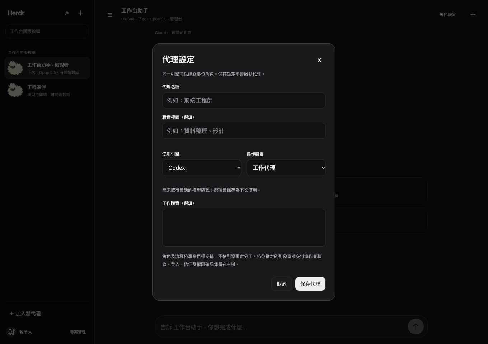
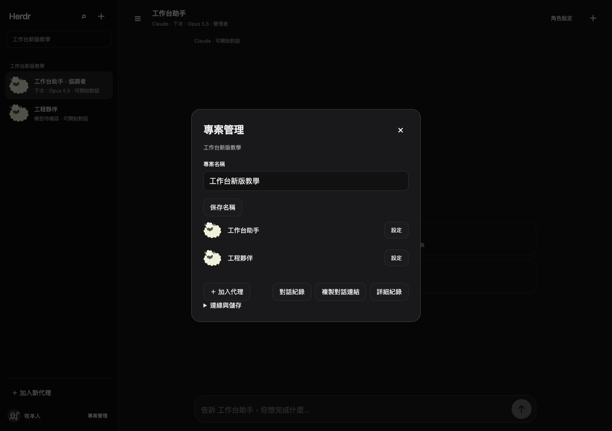
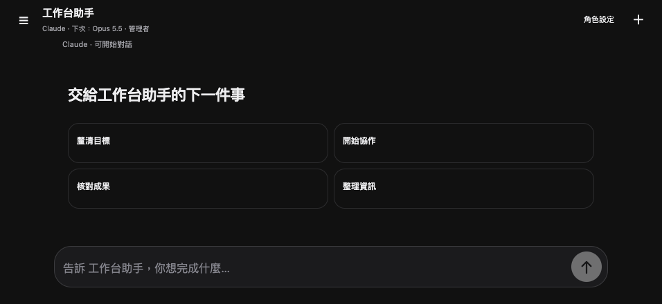

# 工作台操作教學

適用 0.2.0-dev。截圖來自真正部署的工作台與專用教學專案，不含私人對話、登入資料或作者主機網址。手機／平板圖片是 Chrome 響應式檢查，與 iOS 實機驗收分開記錄。

## 1. 建立專案：先有一隻羊

左側右上角「＋」建立專案，先有「我的助手」。其他代理由你新增，不會為了建立專案就啟動工作。已設定 Google Drive 時，工作檔案放在各自獨立的 Drive 專案資料夾。

起手建議只填入草稿。修改後由你按傳送，才會交付任務。

## 2. 加入、改名與任命

左側「＋ 加入新代理」可選 Claude、Codex、MiniMax 或 Google 個人版 Antigravity。同一引擎可建立多位角色。保存設定不代表已啟動或完成登入。

選一隻羊，按上方「角色設定」改名、修改職責，或選擇 Claude 的 Opus／Fable。模型切換只有收到真正 CLI 確認才顯示套用成功；沒有會話時則保存為下次使用。

由你按「任命為協調者（Opus）」指定管理者，預設使用 Claude Opus 5.5。它只是你指定的協調角色，不是所有訊息的必經中介；每位代理仍可直接對話。

「專案管理」可改專案顯示名稱，保留原資料夾、專案 ID、檔案與對話。

## 3. 直接和代理說話

點左側的代理，訊息直接送給它；也可以用 `@代理名稱` 指定對象。第一則訊息才會開啟它的工作會話，之後沿用同一會話，不會每句話重新啟動。

「可開始對話」表示尚未為這段對話開啟會話；「啟動中」「待命」「處理中」「等待你確認」反映不同階段。首次啟動仍可能需要模型載入、本人登入或信任確認，不保證固定秒數。

模型顯示來自 CLI、切換確認或官方回覆事件。尚未取得證據時顯示「模型待確認」或「下次使用」，不把預設值當成已生效。

## 4. 讓代理彼此協作與驗收

在某位代理的對話中直接交代，例如：

> 請和工程師一起完成這個功能。你負責拆解與驗收，工程師實作；不符合就請他修正，最後交付可執行成果及測試結果。

代理只能向這個專案已加入的成員交付工作。對方自己的對話會出現任務、完成條件、回覆及修正要求，原交付代理會收取真實回報、核對後驗收。角色與引擎沒有固定工作順序。

聊天內「任務清單」保留進度與證據，不另設協作紀錄頁。排隊、啟動成功或代理自稱完成都不算驗收；結果不符可以退回修正。子協作未驗收時，父任務也不會因暫時停下等待而被標完成。

這仍需要你查看成果。自動化能檢查來源、版本、檔案範圍及雜湊，無法保證每個模型對需求的理解都正確。

## 5. 登入、信任及權限

操作發生在安裝主機，遠端裝置只是控制同一個工作台。首次使用的登入、資料夾信任、瀏覽器授權、檔案權限及付費提示都由本人親自處理。

在主機以 `hc ls` 查真正的終端，再 `hc attach <ID>` 查看；不要照抄別台電腦或過期的 ID。一位代理等確認不會阻擋其他代理聊天。啟動途中退出時，親自按「重新開啟代理」才重試，不能以重開來代替信任確認。

Google 個人帳號使用 Antigravity CLI 的 Google OAuth，不能擅自改成 API key、Cloud 專案或付費方案。Claude 的 Chrome 工具需要在主機 Chrome 擴充功能親自登入、選對裝置並授權。

## 6. 同一個 Tailscale 跨裝置使用

主機保持開機、macOS 登入並連上 Tailscale。其他裝置加入同一 tailnet，使用同一 HTTPS `/herdr/` 入口。

「專案管理 → 複製對話連結」會保留專案、對話與目前代理。名冊由專案共用，對話保存在同一台主機；已開啟的不同對話可各自保留。舊原生 Herdr 的索引不是這個背景 PWA 的即時雙向鏡像，日常請使用同一個 PWA。

iPhone／iPad 在 Safari 分享選單選「加入主畫面」。更新後完整關閉再開啟；新版也會提供保留草稿的重新載入提示。

## 7. Drive 與空間管理

「專案管理 → 連線與儲存」可查看主機 Drive 狀態及設定新專案資料夾。原生 Drive 桌面版負責上傳，對話與執行控制資料留在工作台主機。

資料夾已設定不代表每個檔案已上傳。確認同步及雲端回讀後，才可用 Drive 的「移除下載項目」釋放不用的本機副本；不要刪除同步原檔，也不要讓兩台主機同時對同一 Drive 專案啟動寫入代理。

排版有問題時，使用「專案管理 → 連線與儲存 → 複製版面診斷」。內容只有尺寸與版本，不含對話、憑證或專案路徑，不會自動上傳。實際驗證範圍見 [VALIDATION.md](../VALIDATION.md)。
