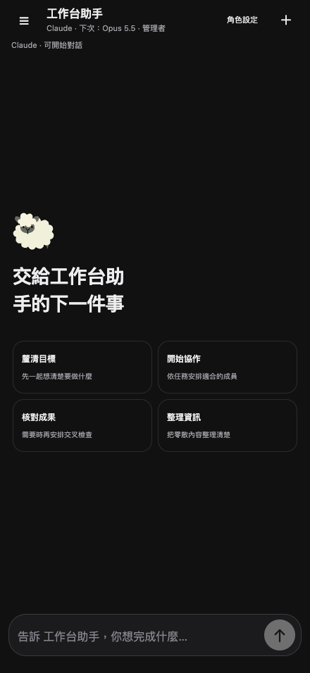
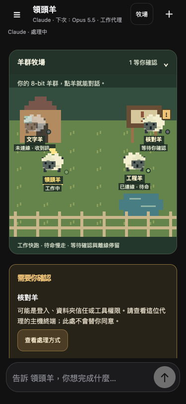

# 工作台操作教學

適用 0.5.0-dev。截圖來自真正部署的工作台與專用教學專案，不含私人對話、登入資料或作者主機網址。手機／平板圖片是 Chrome 響應式檢查，與 iOS 實機驗收分開記錄。

## 1. 建立專案：先有一隻羊

左側右上角「＋」建立專案，先有「領頭羊」。這隻預設羊不能刪除，但可以改名、設定模型；協調者仍由你另外任命。其他代理由你新增，不會為了建立專案就啟動工作。已設定 Google Drive 時，工作檔案放在各自獨立的 Drive 專案資料夾。圖中的「資料羊」是新增並重新命名的教學角色。

起手建議只填入草稿。修改後由你按傳送，才會交付任務。

## 2. 加入、改名與任命

左側「＋ 加入新代理」可選 Claude、Codex、MiniMax 或 Google 個人版 Antigravity。同一引擎可建立多位角色。保存設定不代表已啟動或完成登入。

點羊右側的「⋯ → 設定」，修改職責、選擇 Claude 的 Opus／Fable，或任命協調者；要改名字則直接選「⋯ → 重新命名」。模型切換只有收到真正 CLI 確認才顯示套用成功；沒有會話時則保存為下次使用。

由你按「任命為協調者（Opus）」指定管理者，預設使用 Claude Opus 5.5。它只是你指定的協調角色，不是所有訊息的必經中介；每位代理仍可直接對話。

「設定」可改專案顯示名稱，保留原資料夾、專案 ID、檔案與對話。

### 側欄拖曳與代理選單

滑鼠抓住左邊的點狀把手或代理列，拖到另一列的上半／下半部，放開後保存順序。Pin 的代理固定在上方，順序與 Pin 依專案保存，同一 PWA 的其他裝置也會更新。置頂與一般區域分開排序，跨區前先取消 Pin。

「⋯」集中提供 Pin／取消置頂、設定、重新命名、移至其他專案、向上／向下移動，以及刪除。手機可直接使用上移／下移；鍵盤可開啟選單，以方向鍵選擇、Enter 執行、Esc 關閉，也可在代理主按鈕按 Alt＋↑／↓ 排序。

拖到另一個專案名稱會開啟轉移確認，與「移至其他專案」使用同一流程。移動的是角色名稱、引擎、模型、職責與 Pin 設定；原專案的對話、檔案及歷史會話留在原處，目的專案使用自己的會話，不複製登入資料。刪除也只移除角色設定並停止已核對的閒置 CLI，保留對話與檔案。

排隊訊息、等待中的回覆、執行中／等待權限的 CLI、未完成協作或未驗收待辦會阻擋轉移與刪除。預設領頭羊留在本專案，不能刪除或移出；現任協調者需先任命其他人。轉移／刪除設定前會保存可還原的角色設定備份，保存在主機私有的專案 runtime 目錄。

## 3. 直接和代理說話

點左側的代理，訊息直接送給它；也可以用 `@代理名稱` 指定對象。第一則訊息才會開啟它的工作會話，之後沿用同一會話，不會每句話重新啟動。

「可開始對話」表示尚未為這段對話開啟會話；「啟動中」「待命」「處理中」「等待你確認」反映不同階段。首次啟動仍可能需要模型載入、本人登入或信任確認，不保證固定秒數。

模型顯示來自 CLI、切換確認或官方回覆事件。沒有啟動的對話顯示引擎與「本對話未啟動」，Claude 顯示「下次使用」；已啟動但尚無模型證據才顯示「模型讀取中」，不把預設值當成已生效。

會話可在背景待命，不需每次重新啟動。綁定單位是「專案＋對話＋代理」：另一段對話不會混用這段的上下文，所以同一隻羊在新對話可能尚未啟動。回原本的對話即可沿用原會話；關閉 PWA 不會登出或關閉主機上的工作代理。

### 羊的動作與回覆提示

啟動中，羊輕輕跳動；真正處理任務時，羊會點頭晃動。綠燈表示 CLI 已連線且可用：工作中緩慢閃爍，已連線待命時恆亮。尚未啟動、啟動尚未就緒、已結束、未連線或等待登入／權限確認時，顯示灰燈，旁邊保留文字狀態。開啟系統「減少動態效果」時停止動畫，文字狀態保留。

重開機後，core 保留的總控可能只是 shell，還沒有模型連線，此時是灰燈與「待命，收到訊息後啟動」。傳送訊息後，真正 CLI 就緒才轉綠；不把存在的 shell 當作模型已啟動。

你按送出後，聊天裡會出現「…」：先顯示正在傳送，再區分「等待代理接收」「已送達、等待回覆」與「已收到、正在回覆」。排隊不代表送達。真實回覆到達後提示會移除；等待其他羊回報時則顯示協作等待，不假裝任務已完成。

此圖使用獨立瀏覽器內的介面測試資料，不是模型已執行任務的證據。另已在真正重開機後，以正式 PWA 傳送簡單算術給 Codex，觀察到等待提示，收到真實答案後提示消失。

## 4. 讓代理彼此協作與驗收

在某位代理的對話中直接交代，例如：

> 請和工程師一起完成這個功能。你負責拆解與驗收，工程師實作；不符合就請他修正，最後交付可執行成果及測試結果。

代理只能向這個專案已加入的成員交付工作。對方自己的對話會出現任務、完成條件、回覆及修正要求，原交付代理會收取真實回報、核對後驗收。角色與引擎沒有固定工作順序。

聊天內「任務清單」保留進度與證據，不另設協作紀錄頁。排隊、啟動成功或代理自稱完成都不算驗收；結果不符可以退回修正。子協作未驗收時，父任務也不會因暫時停下等待而被標完成。

這仍需要你查看成果。自動化能檢查來源、版本、檔案範圍及雜湊，無法保證每個模型對需求的理解都正確。

## 5. 登入、信任及權限

操作發生在安裝主機，遠端裝置只是控制同一個工作台。首次使用的登入、資料夾信任、瀏覽器授權、檔案權限及付費提示都由本人親自處理。

在主機以 `hc ls` 查真正的終端，再 `hc attach <ID>` 查看；不要照抄別台電腦或過期的 ID。一位代理等確認不會阻擋其他代理聊天。啟動途中退出時，親自按「重新開啟代理」才重試，不能以重開來代替信任確認。

舊總控終端若被刪除，原訊息仍在佇列；按「重新開啟總控」明確重試，工作台驗證終端確實不存在後，才用 core 回傳的真實新終端續接。若只是 core 暫時斷線，不會擅自建立第二個總控；登入與信任仍需本人處理。

Google 個人帳號使用 Antigravity CLI 的 Google OAuth，不能擅自改成 API key、Cloud 專案或付費方案。Claude 的 Chrome 工具需要在主機 Chrome 擴充功能親自登入、選對裝置並授權。

## 6. 同一個 Tailscale 跨裝置使用

主機保持開機、macOS 登入並連上 Tailscale。其他裝置加入同一 tailnet，使用同一 HTTPS `/herdr/` 入口。

「設定 → 複製對話連結」會保留專案、對話與目前代理。名冊由專案共用，對話保存在同一台主機；已開啟的不同對話可各自保留。舊原生 Herdr 的索引不是這個背景 PWA 的即時雙向鏡像，日常請使用同一個 PWA。

iPhone／iPad 在 Safari 分享選單選「加入主畫面」。更新後完整關閉再開啟；新版也會提供保留草稿的重新載入提示。

重開機後先登入 macOS。工作台兩個使用者背景服務會在登入後啟動；Tailscale 也必須已連線，Drive 專案還需等串流資料夾就緒。若看到 `Failed to fetch` 及空白清單，可能只是離線快取外殼，請先恢復主機網路，不要重建專案。登入啟動和 VPN On Demand 的設定請依 [Tailscale 官方說明](https://tailscale.com/docs/features/client/ios-vpn-on-demand) 操作；登入、網路與系統權限由本人處理。

本次同機第二次真正重開機已確認：使用者未手動按 Connect、未開 Herdr，登入後 Tailscale 自行連線、兩個背景服務與 HTTPS 入口正常，專案與對話保留。這是登入 macOS 後的恢復，不代表登入前、所有網路或其他新機都已驗證。

CLI 程序不能跨重開機原地存活；工作台保留對話與名冊，下一則訊息依真實會話狀態重新啟動。舊總控可依已記錄的 Claude 會話續接。一次成功的重新連線，不等於所有引擎的 CLI 上下文與所有網路條件都已驗證。

## 7. Drive 與空間管理

「設定 → 連線與儲存」可查看主機 Drive 狀態及設定新專案資料夾。原生 Drive 桌面版負責上傳，對話與執行控制資料留在工作台主機。

資料夾已設定不代表每個檔案已上傳。確認同步及雲端回讀後，才可用 Drive 的「移除下載項目」釋放不用的本機副本；不要刪除同步原檔，也不要讓兩台主機同時對同一 Drive 專案啟動寫入代理。

安全操作順序：先確認 Drive 上傳完成及雲端原始內容雜湊相符，再在 Finder 右鍵選取該檔的「移除下載項目」，核對本機只剩佔位檔、雲端仍可下載。只對已驗證且不在使用中的範圍操作，不能把一個測試檔的結果擴大套用到所有專案。重新開啟佔位檔時，Drive 可能按需下載。

排版有問題時，使用「設定 → 連線與儲存 → 複製版面診斷」。內容只有尺寸與版本，不含對話、憑證或專案路徑，不會自動上傳。實際驗證範圍見 [VALIDATION.md](../VALIDATION.md)。

## 牧場看進度

對話上方「羊群牧場」可收合。點羊會選取同一位代理；不會送出訊息，也不自動啟動它。8-bit 羊工作中快跑與綠點閃爍，待命慢走，未連線灰點並停留，等你確認有驚嘆號。狀態只涵蓋目前對話，不冒充所有主機會話。

展開「任務進度」與卡片，可查看誰負責、驗收條件、待處理原因與核對結果。「已回覆」和「已驗收」不同。若出現「需要你確認」，按「查看處理方式」，在 Mac mini 親自閱讀相對應終端的提示。

通知入口是「設定 → 通知」，只在你點按時要求系統授權。第一次開啟後請用測試通知確認手機實際收到；拒絕通知不影響頁面提醒與原有代理安全設定。
