# 工作台操作教學

適用 0.8.11-dev 的 v52 介面。開啟 Herdr「設定」，標題下方會顯示版號。截圖使用專用教學資料。早期截圖示範基本操作，手機／平板的 Chrome 響應式檢查與 iOS 實機驗收分開記錄。

目前驗收及待辦統一見 [完成與待辦](CHECKLIST.md)。最近四項介面與代理流程改進已完成，v52 公開安裝包另通過全新 macOS 雲端安裝。手機附件測試依要求暫緩，恢復前不需重新選圖或送出測試訊息。

側欄與聊天區的捲軸已隱藏。可用滑鼠滾輪、觸控板或手指捲動；鍵盤使用者可聚焦捲動區後按 Page Up／Page Down。

在「設定 → 用量與額度」，先看各引擎最近回報的帳號剩餘百分比和重設時間，再查看目前對話的 token。若某個週期的額度尚未回報，或已到重設時間，等引擎更新後才會顯示。Codex 的帳號額度在各專案共用。MiniMax 的通用及影片額度來自主機登入的官方 `mmx` 帳號。

## 1. 建立專案：先有一隻羊

左側右上角「＋」建立專案，先有「領頭羊」。這隻預設羊不能刪除，但可以改名、設定模型；協調者仍由你另外任命。其他代理由你新增，不會為了建立專案就啟動工作。已設定 Google Drive 時，工作檔案放在各自獨立的 Drive 專案資料夾。圖中的「資料羊」是新增並重新命名的教學角色。

起手建議只填入草稿。修改後由你按傳送，才會交付任務。

## 2. 加入、改名與任命

左側「＋ 加入新代理」可選 Claude、Codex、MiniMax 或 Google 個人版 Antigravity。同一引擎可建立多位角色。保存設定不代表已啟動或完成登入。

側欄羊的名稱下方會顯示目前模型與待命狀態。切換對話時，尚未啟動的羊會顯示上次確認的模型；沒有確認紀錄時，顯示已選的下次模型或引擎。

點羊右側的「⋯ → 設定」，修改職責、選擇 Claude 的 Opus／Fable，或任命協調者；要改名字則直接選「⋯ → 重新命名」。模型切換只有收到真正 CLI 確認才顯示套用成功；沒有會話時則保存為下次使用。

由你按「任命為協調者（Opus）」指定管理者，預設使用 Claude Opus 5.5。它只是你指定的協調角色，不是所有訊息的必經中介；每位代理仍可直接對話。

側欄直接以專案名稱區分工作。從名稱旁的編輯按鈕可改名，原資料夾、專案 ID、檔案與對話都會保留。

### 側欄拖曳與代理選單

滑鼠抓住左邊的點狀把手或代理列，拖到另一列的上半／下半部，放開後保存順序。Pin 的代理固定在上方，順序與 Pin 依專案保存，同一 PWA 的其他裝置也會更新。置頂與一般區域分開排序，跨區前先取消 Pin。

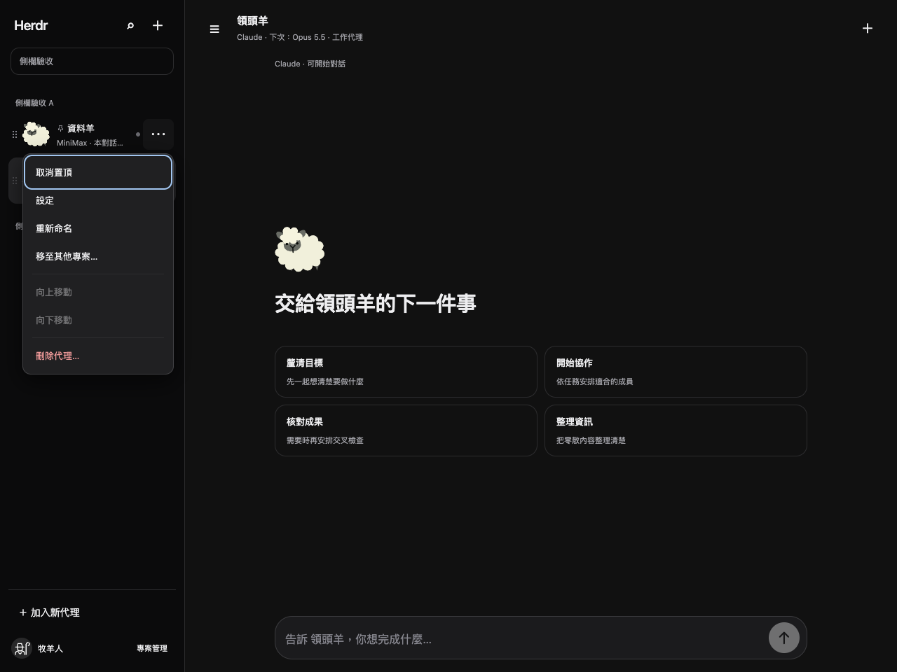

「⋯」集中提供 Pin／取消置頂、設定、重新命名、移至其他專案、向上／向下移動，以及刪除。手機可直接使用上移／下移；鍵盤可開啟選單，以方向鍵選擇、Enter 執行、Esc 關閉，也可在代理主按鈕按 Alt＋↑／↓ 排序。

拖到另一個專案名稱會開啟轉移確認，與「移至其他專案」使用同一流程。移動的是角色名稱、引擎、模型、職責與 Pin 設定；原專案的對話、檔案及歷史會話留在原處，目的專案使用自己的會話，不複製登入資料。刪除也只移除角色設定並停止已核對的閒置 CLI，保留對話與檔案。

排隊訊息、等待中的回覆、執行中／等待權限的 CLI、未完成協作或未驗收待辦會阻擋轉移與刪除。預設領頭羊留在本專案，不能刪除或移出；現任協調者需先任命其他人。轉移／刪除設定前會保存可還原的角色設定備份，保存在主機私有的專案 runtime 目錄。

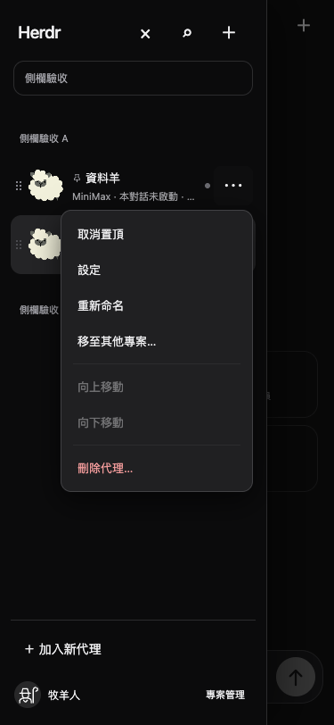

## 3. 直接和代理說話

點左側的代理，就會看見它在目前專案的時間線。歷史訊息按日期和時間排列，你可以在同一頁繼續聊，也能用 `@代理名稱` 指定收件人。

- **翻閱歷史訊息。** 捲到頂端，點「載入更早的訊息」。其他專案的同名代理各自有時間線。
- **接續舊任務。** 點訊息旁的「查看原任務」。舊分享連結和通知仍會開到原任務所在的範圍，附件、任務與驗收沿用原本的識別碼。
- **找回草稿。** 若這台裝置在舊對話有文字草稿，可從「設定 → 其他草稿」打開。跨裝置可讀取主機上已送出的訊息。

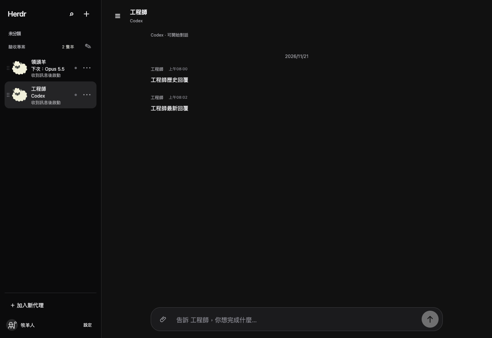

「可開始對話」表示尚未為這段對話開啟會話；「啟動中」「待命」「處理中」「等待你確認」反映不同階段。首次啟動仍可能需要模型載入、本人登入或信任確認，不保證固定秒數。

模型顯示來自 CLI、切換確認或官方回覆事件。沒有啟動的對話顯示引擎與「本對話未啟動」，Claude 顯示「下次使用」；已啟動但尚無模型證據才顯示「模型讀取中」，不把預設值當成已生效。

代理可在背景待命。時間線會整合畫面上的歷史訊息，執行會話仍沿用各任務的來源範圍和專案記憶。關閉 PWA 後，主機上的工作代理可繼續執行。

跨舊對話記憶修正會在交付訊息時，從同專案、同代理的其他對話選取近期與問題相關的訊息，提供內容、時間與原對話來源。舊附件沿用原路徑。代理可以依這些資料回憶之前的交代；資料不足時應明確說明。每回合最多約 24,000 字元，重要長期資訊可另存於「設定 → 專案記憶」。

v43 會快取已解析紀錄並只解析追加的內容；檔案替換或縮短時重建。更新「專案記憶」後，後續任務會優先使用最新保存的決策。瀏覽舊訊息仍可看到當時的內容與日期。

### 羊的動作與回覆提示

啟動中，羊輕輕跳動；真正處理任務時，羊會點頭晃動。綠燈表示 CLI 已連線且可用：工作中緩慢閃爍，已連線待命時恆亮。尚未啟動、啟動尚未就緒、已結束、未連線或等待登入／權限確認時，顯示灰燈，旁邊保留文字狀態。開啟系統「減少動態效果」時停止動畫，文字狀態保留。

重開機後，core 保留的總控可能只是 shell，還沒有模型連線，此時是灰燈與「待命，收到訊息後啟動」。傳送訊息後，真正 CLI 就緒才轉綠；不把存在的 shell 當作模型已啟動。

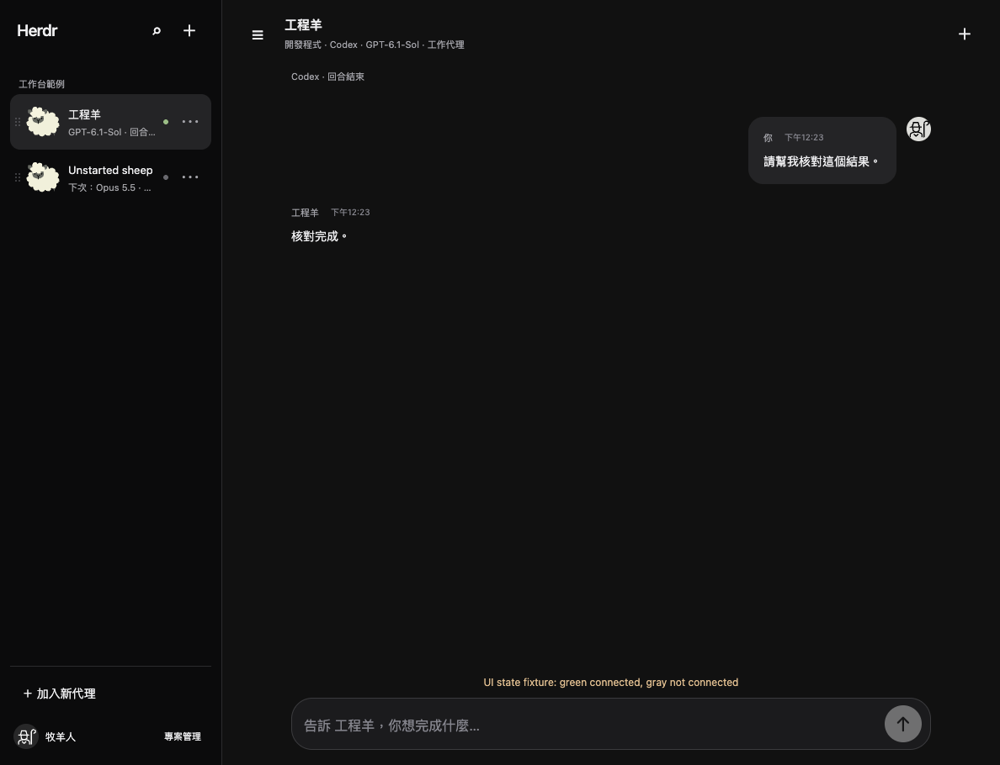

按送出後，聊天會顯示傳送、排隊、接收和回覆狀態。代理正在處理前一則時，畫面會說明新訊息已排隊。已送達但尚無可配對的回覆時，顯示「回覆未核對」。等待其他代理回報時，顯示「正在等協作回報」。

等待提示也會列出經過時間、原因和最後可觀察進度。超過 90 秒沒有新進度時，會提供「查看任務」，可核對狀態或停止自己的任務。等待計時期間可繼續用鍵盤操作。

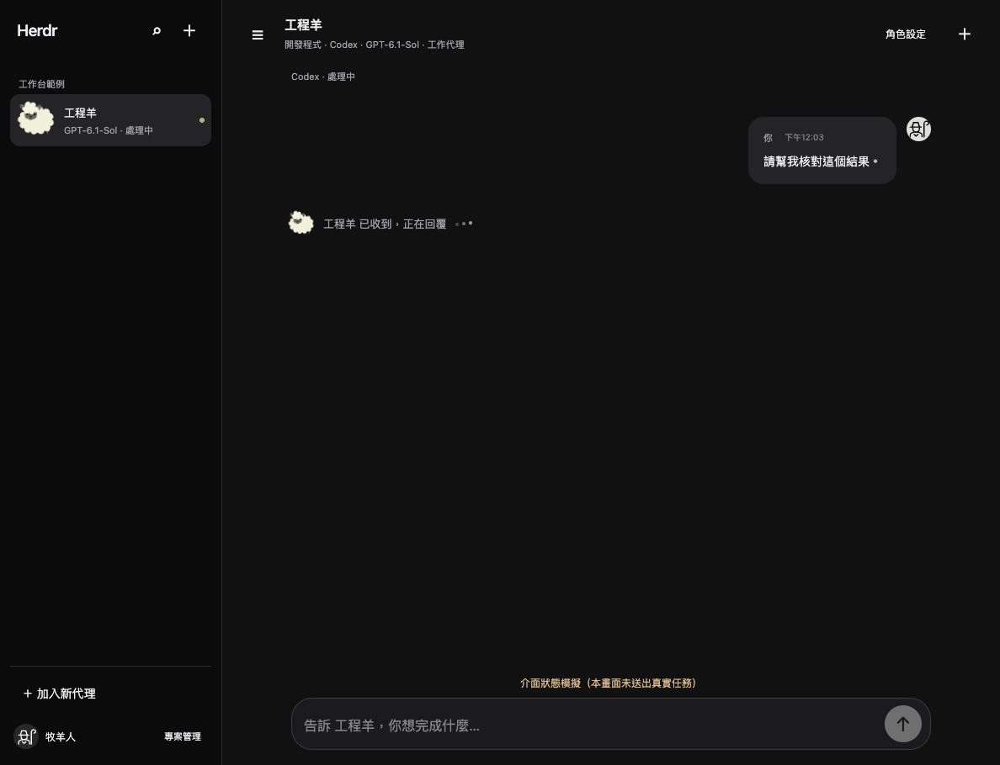

此圖使用獨立瀏覽器內的介面測試資料，不是模型已執行任務的證據。另已在真正重開機後，以正式 PWA 傳送簡單算術給 Codex，觀察到等待提示，收到真實答案後提示消失。

## 4. 三種派工方式

1. **文字指定人選。** 在領頭羊的對話說「分析完需求後請工程師實作，跑完測試再由你驗收」。領頭羊會把具體任務與驗收條件交給同專案的工程師。
2. **由領頭羊自動分工。** 在領頭羊的對話只寫目標與完成條件，例如「整理本週營運數字，請獨立核對後交付摘要」。領頭羊依需求選現有成員，只有自己且需要協作時，可以建立一位代理並派工。
3. **直接交辦給代理。** 點側欄的工程師，直接說「核對這次變更，列出測試結果」。訊息會送往該代理，回覆出現在同一個對話。輸入訊息開頭的 `@代理名稱` 也可選擇直接收件者。

從左下「設定 → 任務進度」查看送達、回報、退回修正及驗收。舊訊息的「查看原任務」會直接打開對應的任務卡。領頭羊先核對真實回報才完成驗收。角色與引擎依專案需求安排，跨代理交付在同一專案內進行。

新代理遇到登入、資料夾信任或工具權限時，在主機終端由你親自確認。代理在處理前一則訊息時，新訊息會順序排隊。

### 附檔給代理

1. 打開要收件的代理對話，點輸入框旁的迴紋針，或把檔案從 Finder 拖到聊天區。出現「放開以加入附件」後放開，檔案就會加入草稿。每則最多 4 個檔案，每檔上限 15 MB。
2. 選檔後確認草稿上方的檔名。要移除某份檔案，點檔名旁的「×」。可以加一句「只讀附件，回覆核對結果」。
3. 按送出才會上傳。附件存於當前專案的「Herdr 附件」資料夾，代理會取得專案內的檔案路徑。若當前專案在 Google Drive，附件也存到該專案。可讀格式依收件代理和工具而定。

4. PNG、JPEG、WebP、GIF 及 AVIF 圖片可點縮圖預覽，再按「×」或 Esc 返回。上傳時每份檔案顯示百分比。失敗會保留檔名、草稿和錯誤說明；確認網路後按「重試傳送附件與訊息」。看到「已上傳，等待傳送訊息」後，仍要等訊息收件狀態更新。

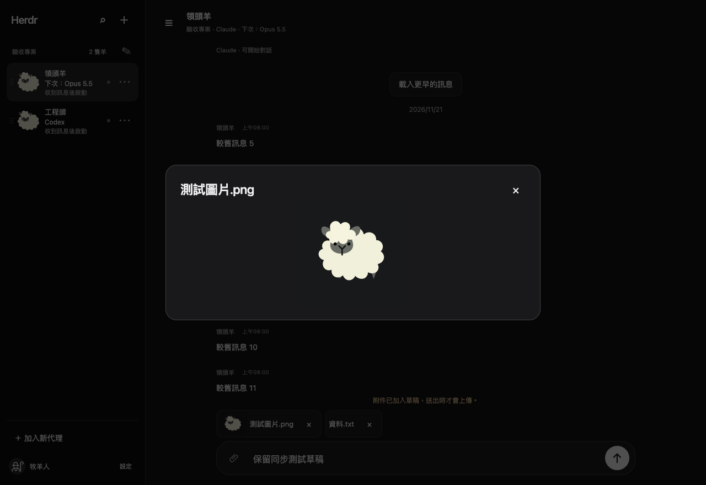

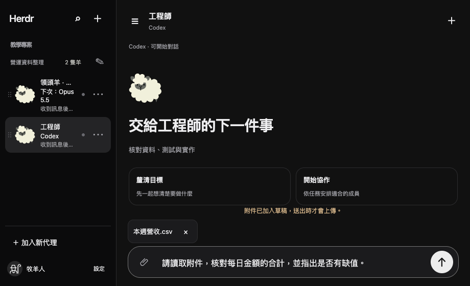

### 選擇領頭羊引擎

從領頭羊的「⋯ → 設定」選「使用引擎」。選 Claude 時可另外選 Opus 5.5 或 Fable 5.2；選 Codex 時使用主機 Codex CLI 的模型設定。保存後，在同一個對話送出下一則訊息。若舊總控仍在工作或等子代理回報，工作台先保留排隊，等目前工作結束再切換。任命現有代理時會沿用已設定的引擎。

## 5. 登入、信任及權限

操作發生在安裝主機，遠端裝置只是控制同一個工作台。首次使用的登入、資料夾信任、瀏覽器授權、檔案權限及付費提示都由本人親自處理。

在主機以 `hc ls` 查真正的終端，再 `hc attach <ID>` 查看；不要照抄別台電腦或過期的 ID。一位代理等確認不會阻擋其他代理聊天。啟動途中退出時，親自按「重新開啟代理」才重試，不能以重開來代替信任確認。

舊總控終端若被刪除，原訊息仍在佇列；按「重新開啟總控」明確重試，工作台驗證終端確實不存在後，才用 core 回傳的真實新終端續接。若只是 core 暫時斷線，不會擅自建立第二個總控；登入與信任仍需本人處理。

Google 個人帳號使用 Antigravity CLI 的 Google OAuth，不能擅自改成 API key、Cloud 專案或付費方案。Claude 的 Chrome 工具需要在主機 Chrome 擴充功能親自登入、選對裝置並授權。

## 6. 同一個 Tailscale 跨裝置使用

主機保持開機、macOS 登入並連上 Tailscale。其他裝置加入同一 tailnet，使用同一 HTTPS `/herdr/` 入口。

v43 的前景頁面會接收主機的即時更新訊號，再取得目前專案與代理的資料。連線中斷會重連並保留輪詢。切回 App 時會重新核對最新狀態，未送出的草稿保留在原裝置。

「設定 → 複製對話連結」會保留專案、對話與目前代理。名冊由專案共用，對話保存在同一台主機；已開啟的不同對話可各自保留。舊原生 Herdr 的索引不是這個背景 PWA 的即時雙向鏡像，日常請使用同一個 PWA。

iPhone／iPad 在 Safari 分享選單選「加入主畫面」。更新後可從 App 切換器關閉 Herdr，再點主畫面圖示重新開啟。

重開機後先登入 macOS。工作台兩個使用者背景服務會在登入後啟動；Tailscale 也必須已連線，Drive 專案還需等串流資料夾就緒。若看到 `Failed to fetch` 及空白清單，可能只是離線快取外殼，請先恢復主機網路，不要重建專案。登入啟動和 VPN On Demand 的設定請依 [Tailscale 官方說明](https://tailscale.com/docs/features/client/ios-vpn-on-demand) 操作；登入、網路與系統權限由本人處理。

本次同機第二次真正重開機已確認：使用者未手動按 Connect、未開 Herdr，登入後 Tailscale 自行連線、兩個背景服務與 HTTPS 入口正常，專案與對話保留。這是登入 macOS 後的恢復，不代表登入前、所有網路或其他新機都已驗證。

CLI 程序不能跨重開機原地存活；工作台保留對話與名冊，下一則訊息依真實會話狀態重新啟動。舊總控可依已記錄的 Claude 會話續接。一次成功的重新連線，不等於所有引擎的 CLI 上下文與所有網路條件都已驗證。

## 7. Drive 與空間管理

「設定 → 連線與儲存」可查看主機 Drive 狀態及設定新專案資料夾。原生 Drive 桌面版負責上傳，對話與執行控制資料留在工作台主機。

資料夾已設定不代表每個檔案已上傳。確認同步及雲端回讀後，才可用 Drive 的「移除下載項目」釋放不用的本機副本；不要刪除同步原檔，也不要讓兩台主機同時對同一 Drive 專案啟動寫入代理。

安全操作順序：先確認 Drive 上傳完成及雲端原始內容雜湊相符，再在 Finder 右鍵選取該檔的「移除下載項目」，核對本機只剩佔位檔、雲端仍可下載。只對已驗證且不在使用中的範圍操作，不能把一個測試檔的結果擴大套用到所有專案。重新開啟佔位檔時，Drive 可能按需下載。

排版有問題時，使用「設定 → 連線與儲存 → 複製版面診斷」。內容只有尺寸與版本，不含對話、憑證或專案路徑，不會自動上傳。實際驗證範圍見 [VALIDATION.md](../VALIDATION.md)。

## 任務進度與提醒

開啟已驗收的成果。檔案位於主機設定的 Google Drive 串流範圍，且 Drive 已提供檔案 ID 時，預覽視窗會顯示「在 Google Drive 開啟」。點選時工作台會重新檢查驗收雜湊。Drive 原檔的存取依原本的 Google 帳號權限。

目前版本已移除牧場及其設定。直接從專案側欄選代理聊天；原綿羊頭像、綠點與工作提示保留。

展開「任務進度」與卡片，可查看誰負責、驗收條件、待處理原因與核對結果。「已回覆」和「已驗收」不同。若出現「需要你確認」，按「查看處理方式」，在 Mac mini 親自閱讀對應終端的提示。

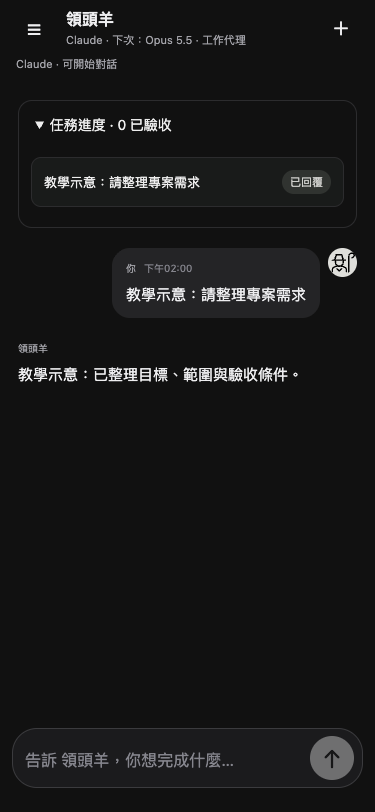

通知入口仍是「設定 → 通知」，不需因移除牧場重新授權。先前版本截圖若包含牧場，屬歷史版本畫面。

新增代理只需名稱和引擎，細節在代理的「⋯ → 設定」再編輯。點側欄專案右側的編輯按鈕，即可修改專案名稱。

展開任務卡可取消未送出的聊天訊息，或停止已核對仍在執行的直接聊天回合。已寫入的檔案會保留。舊總控及代理間的執行回合仍由主機終端處理。

先到「設定 → 任務進度」，展開對應任務。尚未交付的訊息可按「取消排隊」，正在執行且可核對的直接回合可按「停止執行」，並確認畫面提示。狀態更新後，可以在同一隻羊的輸入框交付下一項任務。

### iPhone 附件與跨裝置驗收

用同一個 Tailscale 網址，在 iPhone 主畫面 PWA 和電腦開啟同一專案、同一位代理。從 iPhone 的迴紋針選取檔案或照片，確認附件名稱顯示後，輸入要代理讀取的內容並送出。電腦頁面會讀取主機更新，確認訊息及代理回覆是否出現。要確認圖片閱讀，可以使用自己寫的一行測試文字截圖，請代理讀出文字，再比對原圖。真正 iPhone 的操作與電腦手機尺寸檢查各自記錄結果。

新主機安裝前可先核對 [最新公開 ZIP 的乾淨 macOS 安裝紀錄](https://github.com/virus11456/herdr-workbench/actions/runs/44932391371)。實體 Mac 的模型登入、Drive、Tailscale 和重開機需要在該主機完成驗收。

### 接續工作、成果與協作

- 任務卡的「重新編輯」載入已取消的原訊息。「準備接續」會把停止的任務與檢查既有成果的要求載入草稿。請確認收件者及內容再送出。
- 展開已驗收的任務卡，點成果檔名預覽或下載。檔案修改後需重新驗收。
- 請領頭羊分工時，在訊息中寫清楚目標或指定人選。開頭的 `@` 用來指定直接收件代理。
- 在「設定」可管理「專案記憶」，查看「用量與額度」，也可從「維護工作」準備修正及測試草稿。合併、部署與發布需另行確認。
- 在「用量與額度」查看各引擎已記錄的輸入、輸出及快取 token。Codex 額度附回報及重設時間。實付費用以各引擎的帳單為準。

## Skill 安裝確認

1. 代理提出安裝需求時，對話會跳出「安裝 Skill？」視窗，列出名稱、來源、版本、安裝位置與用途／權限。
2. 選「同意這次安裝」才會授權該代理繼續；選「拒絕」則要求代理停止安裝。關閉視窗表示稍後處理，沒有授權。
3. 待處理請求保留在原代理的聊天區，點「檢視安裝請求」可重新開啟。合併顯示的舊對話也會保留請求原本的範圍。
4. 同意只代表授權，安裝是否成功須看代理的實際回報及驗證。一般連網授權與 Skill 安裝各自獨立。

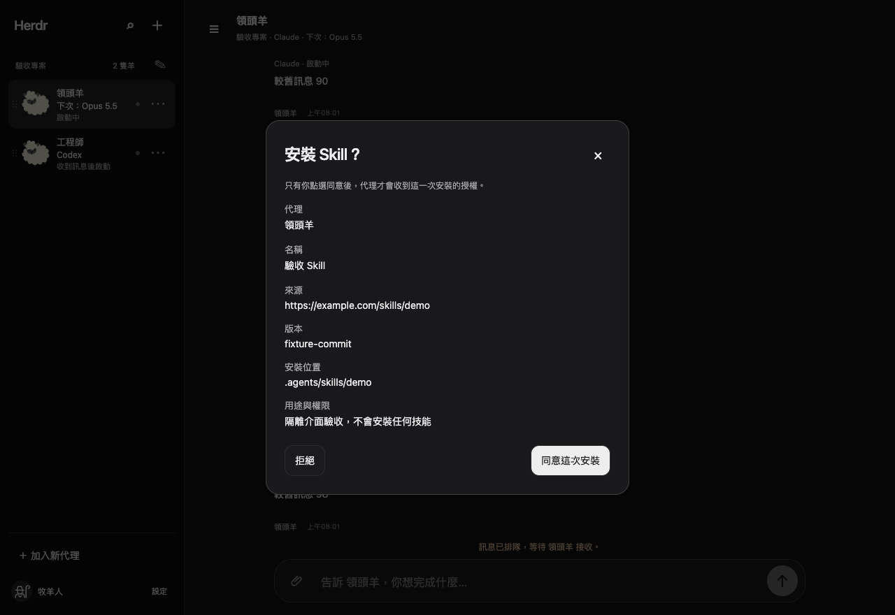

## Google 夥伴讀取網頁與重開機恢復

可直接交付「讀取這個網址，根據原文回答」給 Google 夥伴。此主機實測可在保留沙箱下使用 curl 進行 HTTPS GET，回傳內容經工具紀錄與聊天結果核對；不能把搜尋摘要當成已讀原文。此輪的原生 read_url_content 沒有確認可用。

重開機後，若 Core 明確確認舊終端已不存在，有新排隊訊息時會保留舊紀錄並啟動一次新會話。未送達的新訊息接續交付，不重送舊任務；Core 暫時無法連線或歸屬不符時不會自行建立替代終端。新會話若需要登入或資料夾信任，仍會停下等你親自處理。

## 臨時工作代理也能直接聊天

v52 會自動核對仍在運作的舊工作代理，把它登記成一般成員，沿用原本的終端並保留已公開的工作回報。之後直接點側欄代理即可交辦，不必先手動轉成名冊成員。

若主機暫時無法核對、成員已移動或刪除，不會憑名稱重建代理。舊回報仍保留在原對話；忙碌時新訊息排隊，避免插入原派工。完整說明見下方「代理建立流程統一」。

## 訊息狀態與長對話更新

送出後的提示會依同一筆訊息更新：

- 「訊息已排隊」：主機已收下，尚未確認送達代理。
- 「訊息已送達」：已取得該訊息的送達紀錄，仍在等回覆。
- 代理的配對回覆出現後，收件提示會清除；回覆繼續留在聊天裡。若還有協作進行中，下方進度會繼續顯示實際狀態。

舊任務的回覆不會清掉下一筆任務的排隊提示；取消、停止及連線錯誤仍有各自的提示。

長對話更新時只新增或修改有變動的訊息。閱讀上方、選取文字或聚焦表格時，既有內容與位置會保留；已在底部時會跟隨新訊息。按「較早的訊息」仍能載入原有歷史，不會為了加快更新而刪掉對話。模型生成、代理啟動及網路速度另有各自的等待時間。

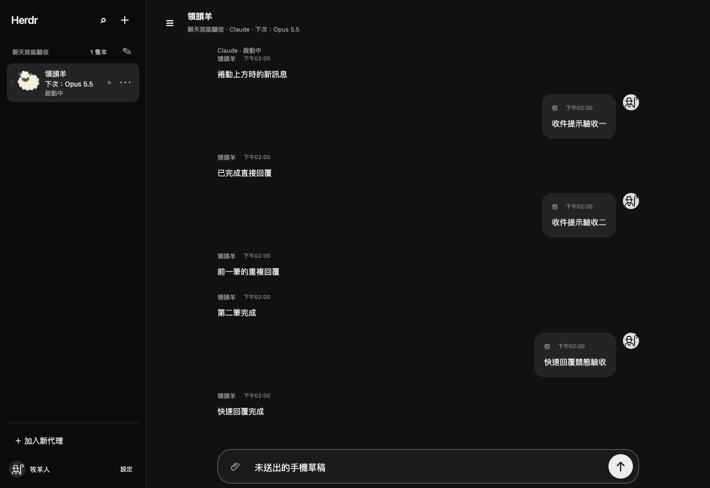

真正 iPhone 的附件驗收：進入指定測試專案，從迴紋針選照片、核對縮圖與預覽，再依引導送出測試文字。要同時確認主機收件、電腦無重整顯示附件、領頭羊讀圖回覆與手機收到相同回覆，才算通過。僅選圖預覽或電腦模擬手機尺寸不算完成上傳驗收。

## 聊天中的協作摘要

有實際派工時，聊天下方會出現「目前協作」，直接列出「領頭羊 → 工程師」、任務和狀態，不需要另外開協作紀錄頁。沒有派工就不顯示，不會依代理口頭宣稱產生工作。

- 等待接收：已排入工作台，尚未確認代理開始執行。
- 送達待核對：正在交付，但尚未取得成功送達的確認；請勿重複交辦。
- 工作中：工作台已確認交付，等待實際回報。
- 待驗收：回報已到，仍須由交付者核對；不代表任務已完成驗收。
- 已驗收：已保存交付者的驗收結果，卡片顯示實際說明。

受阻會明確標示需要處理，退回修正則顯示具體修正要求。登入、信任、Skill 安裝與其他權限確認仍沿用原流程，摘要不會代你核准或自動接受成果。

預設顯示最多三項未完成協作，優先列受阻及待驗收項目，另保留一項最近驗收結果。若有更多工作，點「顯示其餘…項協作」可在同一聊天中展開，再點「收合協作」收回。

「查看詳情」開啟原任務的條件、驗收和成果；若任務在舊會話中，會先切回原會話。「與…對話」可直接進入那位代理的任務會話。摘要只聚合同專案、同代理參與的工作，不混入其他專案；既有詳細任務清單保持原會話範圍。

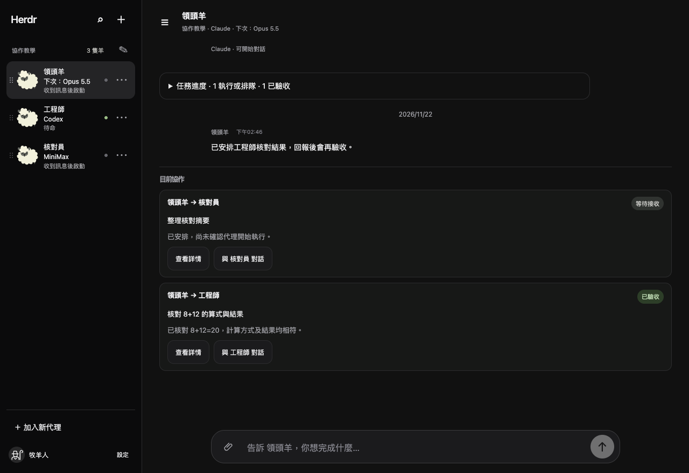

## 代理建立流程統一

所有代理都出現在同一份專案成員名冊，使用相同的聊天輸入框、⋯選單與設定。

1. **自己新增**：點側欄「加入新代理」，填名稱與引擎後儲存。這時只保存成員；送出第一個任務才啟動 CLI。
2. **讓領頭羊建立並派工**：直接描述目標，需要新增人手時由已授權的領頭羊安排。代理登記後就出現在側欄，當次派工依原流程交付。
3. **接續舊工作代理**：主機自動核對仍在運作的原終端，補登記一次；不重送原任務、不重開程序，已公開回報會留在該代理的對話。

之後點任一代理，直接輸入任務即可。若還有原派工未回報，直接訊息先排隊，完成該回合後依序處理；原派工回報給派工者，直接交辦回覆在你與該代理的對話。角色與引擎依任務及你的設定決定，沒有固定部門。

「⋯」可 Pin、重新命名、設定、轉移或刪除。忙碌、等待回覆、未驗收協作、待確認 Skill 或啟動結果不明時會保護代理；不會直接停止工作來完成移動。既有對話和檔案仍保留。

新 Claude 成員預設 Opus 5.5，已有成員的模型與職責不會被改寫。其他引擎顯示 CLI 實際觀察到的模型；無法確認時不猜測。新建或改名會拒絕同名衝突，既有舊設定不會為此被批次改名。

若顯示「啟動結果待核對」，點「核對啟動結果」。主機會先查找原程序；只有本人明確重試且 Core 確認原程序不存在時，才解除不明狀態，讓原排隊訊息接續正常啟動。此按鈕不代按登入、資料夾信任、工具權限或付費提示，也不關閉沙箱。

子目錄工作的 CLI 仍保留原工作目錄和沙箱；專案根目錄只用於成員、模型與回報的歸屬。需要讀取原範圍以外的檔案時，仍遵守原權限限制。自動補登記只接納真實 Core 身分及專案／父終端／對話綁定一致的程序；不從其他電腦複製登入資料。

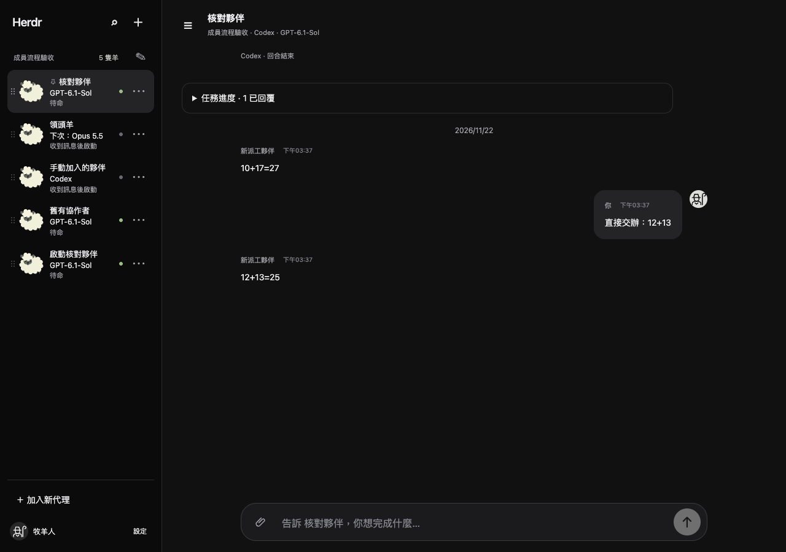

## 換一台主機時的驗收

請依 [README 安裝流程](../README.md#一次設定背景執行) 在新主機使用自己的帳號與專案位置。v52 安裝包已在全新雲端 macOS 完成安裝及 143 項回歸，但新主機仍須本人完成模型、Tailscale，以及選用的 Google Drive 登入與系統授權。

先執行安裝預覽，確認覆寫範圍與備份後再安裝。開啟該主機的 PWA，確認預設領頭羊、自己新增的成員及同一網址的跨瀏覽器同步；再交付小型唯讀任務，核對實際回覆與派工驗收。不要從其他電腦複製登入資料、控制檔或對話資料庫。

真正重開機驗收需先保存其他工作，由本人重新啟動並登入 macOS。不要先手動啟動 Herdr 或按 Tailscale Connect；核對背景服務、網路、既有對話和另一裝置入口後，再判定自動恢復。完成條件見 [待辦總表](CHECKLIST.md#尚未完成)。
