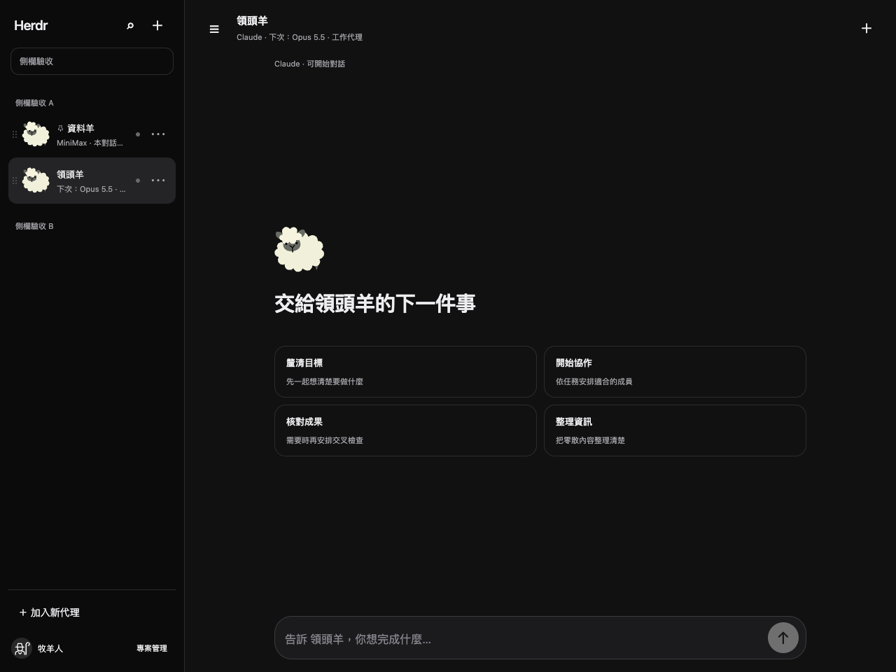
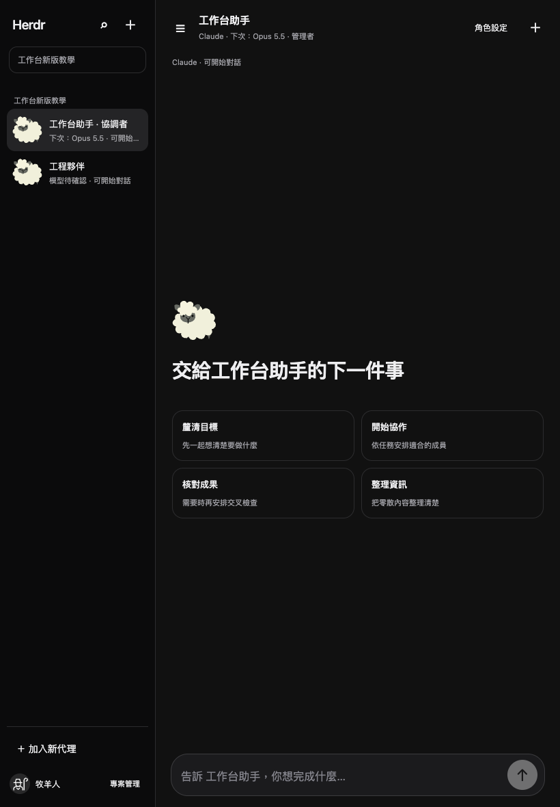

# 工作台操作教學

這些截圖來自實際部署的工作台、獨立測試瀏覽器與專用教學專案。未放入私人對話、登入資料或作者主機網址。手機／平板截圖是 Chrome 的響應式尺寸檢查，不能取代 iOS 實機驗收。

## 1. 建立專案

左側右上角「＋」建立專案。若主機已設定 Google Drive，工作檔案會放進所選 Drive 根目錄下各自獨立的專案資料夾。新專案只有一個協調總控，沒有預設工作代理。

起手建議只會填入草稿。你可以修改文字，再親自按傳送；點建議本身不會派工。

## 2. 加入代理與改名

按左側「＋ 加入新代理」，輸入名稱、引擎、職責與選填的工作說明，按「保存代理」。同一引擎可以加入多位角色。保存角色設定不代表已啟動程序，也不代表完成登入。

切換到該代理後，點上方名稱可改名；總控也可以改名。「專案管理」可編輯角色、開啟對話紀錄或複製目前對話連結。

## 3. 在其他裝置接續同一段對話

所有裝置都使用主機的同一個 Tailscale HTTPS `/herdr/` 入口。一般入口會接續後台最近選取的專案與對話；要明確指定某一段，使用「專案管理 → 複製對話連結」。連結帶有 `project` 與 `chat`，另一台裝置開啟後讀取同一份伺服器資料。

已開啟的不同對話可以並行保留，無須強迫其他裝置切走。名冊是專案共用，訊息與清單屬於各段對話。若代理數量或訊息不同，先核對上方專案名稱及對話連結，避免把不同專案誤認成未同步。

舊 Herdr 原生 mod 使用原生專案索引。背景工作台的 `--import-desktop` 是匯入既有位置，不代表兩套介面已做雙向即時同步。跨裝置日常操作使用同一個 PWA 入口。

## 4. 交付任務與處理主機確認

寫清楚目標、工作範圍、限制與完成條件。總控依已加入的代理及此次需求決定分工；沒有固定引擎職責或固定流程。代理可提出協作請求，再由總控核對與執行。

新專案首次使用 Claude 等工具，可能在主機出現登入、資料夾信任或權限提示。聊天排入佇列不代表工具已就緒；請在主機以 `hc ls` 核對真實終端，再用 `hc attach <ID>` 查看。是否信任與授權由使用者親自決定，工作台不代按確認。

加入代理之後，尚在等待送達的任務會在實際送達前讀取最新名冊；已送出的任務不會因設定更新而重送。

啟動尚未就緒就結束時，服務會停止等待。準備好後在聊天狀態列按「重新開啟總控」，不會反覆自動重開確認流程；使用者仍須親自決定是否信任或授權。舊終端已結束時，以目前登記的真實終端 ID 為準。

## 5. 檢查進度與成果

多步驟或多代理工作使用聊天內的「任務清單」。展開可查看負責人、狀態、驗收條件與證據。只有目前總控能更新；標記完成必須附驗收說明與檔案／同 ID 終端讀取證據。`queued`、啟動成功、代理自稱完成都不能單獨代表驗收通過。

收到彙整結果後，核對實際成果與測試。檔案同步由主機 Google Drive 處理；需要釋放本機空間時，先驗證雲端副本，再使用「移除下載項目」，保留雲端原檔。不要在另一台主機同時對同一 Drive 專案啟動寫入代理。

## 6. 手機與平板

iPhone／iPad 使用 Safari 分享選單「加入主畫面」。主機需要開機、保持 macOS 使用者登入並連上 Tailscale。

遇到裁切或模糊，先完整關閉 PWA 再開啟以更新版本；仍有問題時，在「專案管理 → 連線與儲存 → 複製版面診斷」取得尺寸。這份診斷只含視窗、螢幕、版面矩形與版本，不含對話或憑證，也不會自動上傳。

## 驗證範圍

本次已在真實工作台測試建立專案、新增與改名代理、總控改名、另一個獨立瀏覽器讀取相同名冊、起手草稿不傳送，以及展開由真實總控建立的任務清單。響應式檢查包含 440×956、820×1180、956×440。iPhone PWA 直向且鍵盤關閉的版面由使用者實機確認；其他實機狀態仍分開記錄，見 [驗證狀態](../VALIDATION.md)。
